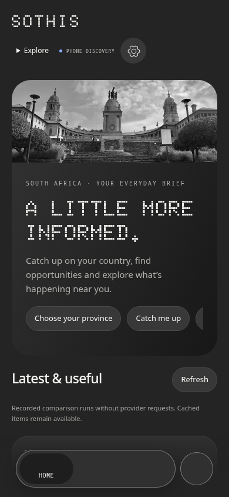
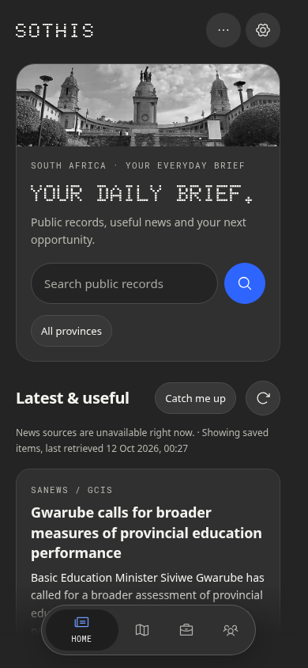
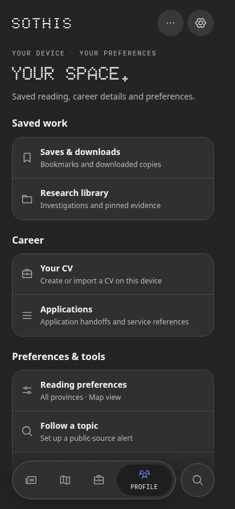

# Sothis 0.8.0 refinement

The refactor preserves the established charcoal, blue, photography and Doto identity. Sketch references were treated as guidance for proportion and consistency. Fresh captures of 0.1.0, 0.2.0, 0.3.0, 0.4.0, 0.6.0 and 0.7.2 informed the comparison; the earlier compact research flow informed the new Home search.

## UI and UX

Regular-weight bundled Phosphor vectors replace file-origin CSS masks. The old masks failed in Android's local-file security model; inline source SVGs now paint without changing file access protections. Typography, spacing, surfaces, icon sizes, touch targets and reduced motion share common foundations. Cards, long titles, URLs and controls wrap within their containers.

Home has a shorter headline and one public-records search. Catch-up appears alongside available stories; topic following lives in Profile. Explore is an anchored menu, Search has one scope disclosure, collection controls appear in collection mode, and alerts require a query. Regions keeps its map/card switch after onboarding. Jobs accepts Enter and retains query/province choices. Profile groups destinations into Saved work, Career, and Preferences & tools. Reading metrics appear when there is history; empty states explain the next action. Settings groups optional connections, provider configuration, evidence information, credits and imports.

Dialogs contain keyboard focus, prevent background scrolling, support Escape/native Back, and restore focus to the opener or equivalent rebuilt row. Non-JSON service failures no longer expose parser exceptions. Native dispatch failures clean up pending requests.

Design references informed hierarchy and contextual controls rather than a visual replacement: [Notion organization](https://www.notion.com/en-gb/help/guides/the-best-way-to-set-up-your-teams-sidebar-for-clear-organization), [Nothing OS](https://us.nothing.tech/nothing-os), and [Apple HIG](https://developer.apple.com/design/human-interface-guidelines).

## Provider and operation fixes

- eTenders ignored keyword filtering in live checks. Both adapters now verify text within a bounded window of up to 90 notices and return a scan cursor. The UI reports matches found and notices checked; it does not treat the portal total as a complete match count. Impossible-keyword check: 0 verified matches/90 checked. Construction check: 11 verified matches/90 checked. More windows remain available.
- Daily data and baselines are keyed by province, query and additional feeds. Existing arrays migrate once. Total provider failures preserve valid cached content and baselines; successful empty responses clear old content. Preference changes force a matching refresh; stale responses cannot replace another filter's data. Expired jobs remain excluded. Empty news offers retry and the official publisher.
- SQLite transaction contexts close in finally after commit/rollback. Backup connections also close on failure. Tests cover actual closure, rollback, commit failure, concurrent independent connections and backup failure. Discovery forwards strict boolean refresh.
- Native vacancy parsing stops at matching nested span boundaries. Challenge/unknown search pages are unavailable rather than false empty results; ordinary fallback remains. Discovery caches are bounded and do not store total failures. RSS/entity normalization and display summaries remove formatting artifacts and repeated leading headlines while retaining source/reader text.
- Native exports resolve saved, handoff or cancelled through callbacks. Private staged files survive supported Activity recreation; finished/cancelled token checkpoints prevent replay and false missing-file messages. Validation rejects traversal/symlinks, copying runs on a separate worker, and cleanup is bounded. Export errors are visible; opening a picker does not claim completion.
- WebView lifecycle pauses reading measurement. Notification entry focuses the actual inbox. Unrelated provider work executes outside the monitor-state lock; monitor updates retain cross-instance serialization.
- Target/compile SDK is 36, minimum SDK remains 26. Modern system-bar, cutout and IME insets are applied by a native safe-area container; older Android keeps its existing keyboard path. The old edge-to-edge opt-out style is removed. Legacy Back opt-out remains supported. See [Android 16 behavior](https://developer.android.com/about/versions/16/behavior-changes-16) and [current Play targeting requirements](https://developer.android.com/google/play/requirements/target-sdk).

## Completed validation

104 Python tests pass with ResourceWarnings promoted to errors. Nine shared UI suites pass; authenticated website checks pass login/CSRF, search, cases/pins, exports/downloads, alerts, regions, persistence and logout. File-origin checks at 320/390 px compare actual painted icon pixels and verify containment, Back and keyboard handling. Broader layout suites cover six widths from 320 to 1280 px. Provider-state checks cover migration, failures, true empty results, expiry, stale callbacks, filter isolation and truthful tender cursors. Native parser, scheduler and export-boundary JVM tests pass.

All ten Java sources compile against the verified official API 36 platform; Java/DEX build and APK v2/v3 signatures pass. The signing certificate matches 0.7.2 and all packaged assets are byte-compared with source. The build refuses to generate a replacement signing identity. Six compiler deprecation warnings remain.

Bounded live checks succeeded for SAnews (10 dated stories), Eastern Cape vacancies (10 listings), public search through its ordinary fallback (10 hits), eTenders (above), and an earlier Parliament refresh (183 ANC members). These are point-in-time checks; the 203 source-directory entries have not all been crawled or individually validated. Other vacancy services and CIPC remain explicit official-browser/authorized-record workflows.

## Visual evidence

These comparable 390×844 captures use 0.7.2 APK assets and current shared assets at file origin, with the same recorded public news and a simulated bridge. They reproduce the missing icons and clipped action in the old version. They are browser rendering evidence, not emulator or phone screenshots.

| Before 0.7.2 | After 0.8.0 |
|---|---|
|  |  |

## Delivery limits

The published APK retains the existing development signing identity for compatible updates and preserved app data. No phone or emulator installation was performed. Runtime cutout/IME animation, Android background scheduling, native chooser apps, and physical Back gestures require device verification. Website source is updated; its production deployment is not changed.

This is a tested development release, not a claim of Play Store approval. Before store submission, complete device acceptance, production app-bundle/signing setup, store listing and accurate privacy/Data safety declarations. [Android signing guidance](https://developer.android.com/studio/publish/app-signing) covers upload keys and Play App Signing. Existing security, provenance and evidence-review boundaries remain in place.
